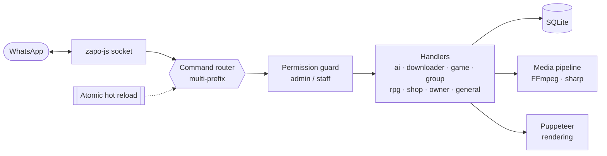
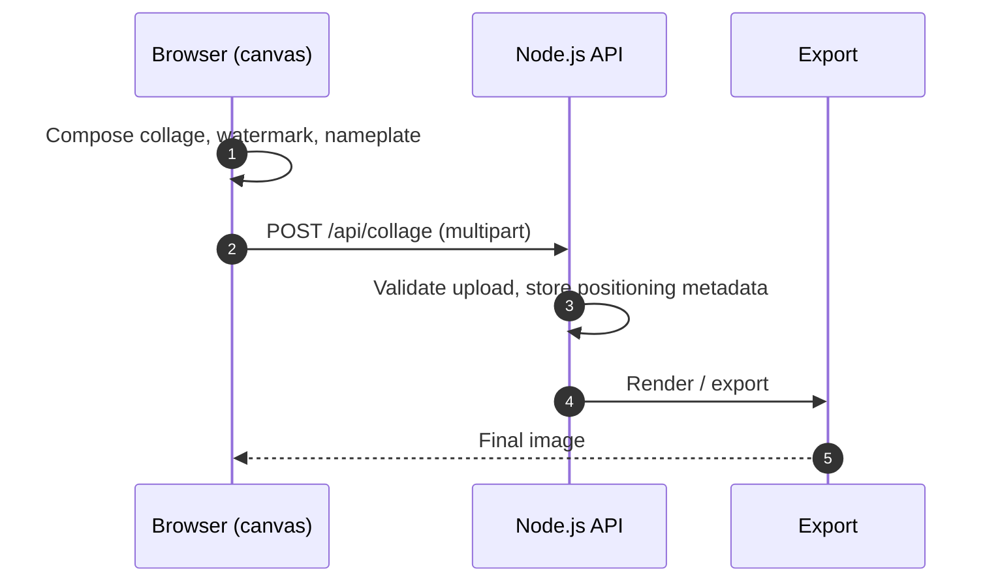

<div align="center">


[](https://git.io/typing-svg)

<br/>

[](https://nodejs.org/)
[](https://www.python.org/)
[](https://nextjs.org/)
[](https://dotnet.microsoft.com/)
[](https://www.sqlite.org/)


</div>

---

## 👨‍💻 About

I build backend services, automation, and web apps, and I own them end to end:
from the architecture decision to the `pm2` process serving traffic.

```js
const alfi = {
  role: "Software Developer",
  primary: ["JavaScript", "Node.js"],
  also: ["Python", "Next.js", "C#/.NET"],
  focus: ["backend services", "automation", "web apps"],
  philosophy: "ship clean, keep infrastructure boring, write code that survives production",
};
```

| | |
|---|---|
| 🧱 **Architecture** | Small, composable modules with clear boundaries |
| 🛡️ **Reliability** | Atomic reloads, persisted state, no downtime on deploy |
| 🚀 **Delivery** | pm2 + Cloudflare Tunnel, HTTPS by default |
| 🔧 **Tooling** | Python and shell for automation, CI-friendly everything |

---

## 🚀 Selected Projects

### 🤖 Claidex-Bot

> Full-featured WhatsApp automation platform built on `zapo-js`: multi-prefix command routing, rich nativeFlow menus, and local SQLite state.



| | |
|---|---|
| **Categories** | `ai` · `downloader` · `game` · `group` · `rpg` · `shop` · `owner` · `general` |
| **Core** | Atomic hot reload, admin/staff permission model, anti-link & welcome flows, sticker/media toolkit |
| **RPG engine** | Characters, combat, quests, crafting, shop, travel, all persisted in SQLite |
| **Media** | YouTube/IG downloader (no API key), FFmpeg transcoding, sharp image pipeline |
| **Infra** | pm2 · Cloudflare Tunnel · WebSocket pairing/QR · Puppeteer rendering |

<br/>

### 🖼️ Claidex Collage

> Web app for composing photo collages with watermark and nameplate overlays. Live at **[collage.cloudku.us.kg](https://collage.cloudku.us.kg)**



| | |
|---|---|
| **Stack** | Node.js · canvas (client-side) · multipart API (`POST /api/collage`) |
| **Design** | Rendering stays on the client; the API stays thin (upload, metadata, export) |
| **Deploy** | pm2 behind Cloudflare Tunnel, HTTPS at `collage.cloudku.us.kg` |

---

## 🛠️ Tech Stack

<div align="center">


</div>

| Language / Framework | Use |
|---|---|
| **JavaScript / Node.js** | Primary: bots, APIs, realtime (ws), tooling |
| **Python** | Scripts, automation, data tooling |
| **Next.js** | React web apps, SSR, dashboards |
| **C# / .NET** | Windows-native and enterprise integrations |
| **SQLite · Puppeteer · FFmpeg · sharp** | Persistence, browser automation, media pipeline |
| **pm2 · Cloudflare Tunnel** | Process management, secure public exposure |

---

## 📊 GitHub Analytics

<div align="center">


<br/>


<br/>


<br/>


</div>

---

## 🌐 Connect

<div align="center">

[](https://www.whatsapp.com/channel/0029VbCOLKRKrWQtIO1vzN0E)
[](https://www.tiktok.com/@claidexdeveloper)
[](https://collage.cloudku.us.kg)

<!-- Add when ready:
[](https://instagram.com/YOUR_HANDLE)
[](https://t.me/YOUR_HANDLE)
-->

</div>


